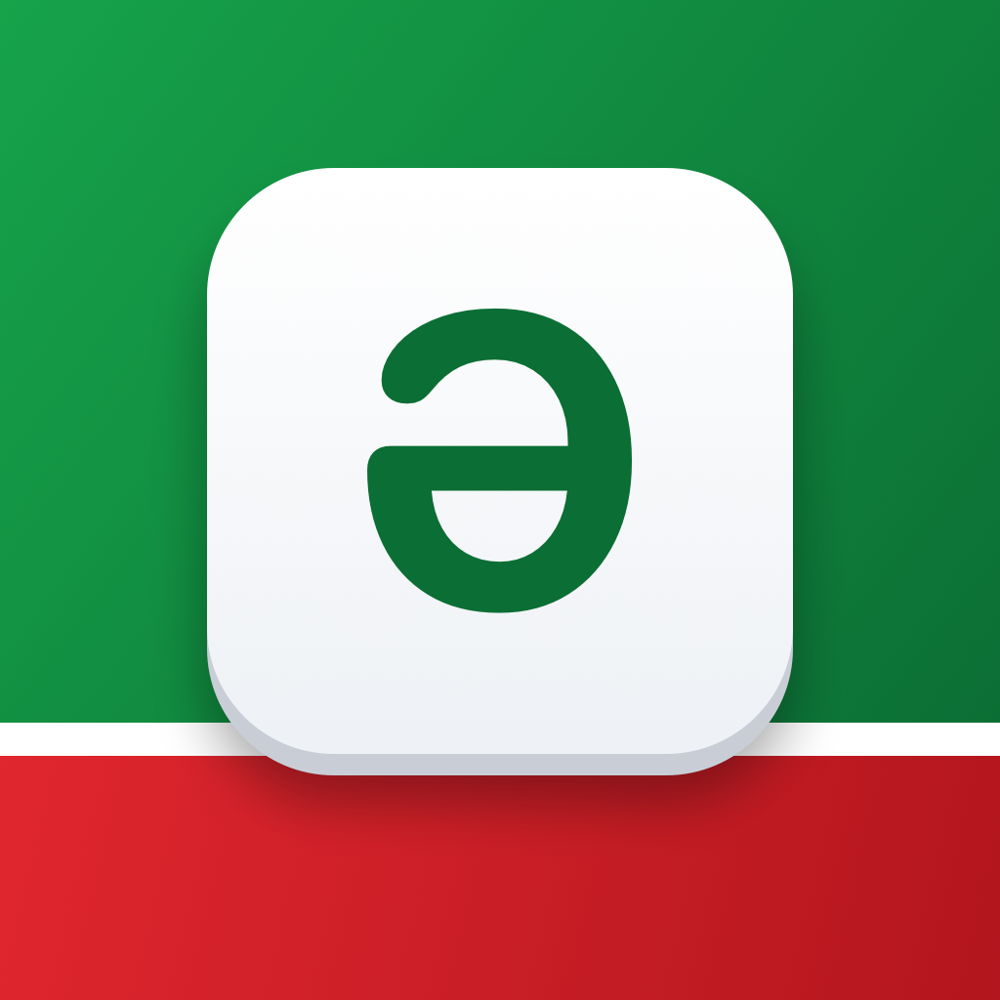

<p align="center">
  
</p>

<h1 align="center">Tatar Keyboard</h1>

<p align="center">
  iOS өчен татар клавиатурасы · Татарская клавиатура для iOS · Tatar keyboard for iOS
</p>

<p align="center">
  <a href="#татарча">Татарча</a> · <a href="#русский">Русский</a> · <a href="#english">English</a>
</p>

---

## Татарча

iPhone һәм iPad өчен татар клавиатурасы: өч язу, сүз тәкъдимнәре, автоалмаштыру һәм свайп белән язу — барысы да телефонның үзендә эшли, интернетсыз.

### Мөмкинлекләр

- **Өч язу:** кирилл, латин (Neo-әlif) һәм гарәп (иске имлә). Пробел янындагы төймә белән алмаштырыла.
- **Татар хәрефләре** озак басуда: а → ә, о → ө, у → ү, н → ң, ж → җ, х → һ, е → ё.
- **Сүз тәкъдимнәре, автоалмаштыру һәм киләсе сүзне фаразлау** — ~113 мең сүз формасыннан торган сүзлек буенча. Мәсәлән, «белан» → «белән», «сонгы» → «соңгы». Автоалмаштырудан соң Backspace язганны кире кайтара.
- **Свайп белән язу:** бармакны хәрефләр буйлап йөртәсең — сүз үзе килеп чыга.
- **iOS клавиатурасындагы кебек:** пробелда курсорны йөртү (трекпад), Shift-ка ике тапкыр басу — Caps Lock, Backspace тотып торганда сүзләп бетерү, ике пробел → нокта, кабатлану, өч битле символлар, эмодзи (соңгы кулланылганнары белән).
- **Кыр төренә җайлашу:** сан, телефон, e-mail, URL кырлары өчен аерым төймәләр.
- **Тавыш һәм тибрәнү** — кушымтада көйләнә. Караңгы тема, VoiceOver.

### Ничек урнаштырырга

App Store-да кушымта әлегә юк — аны Mac аша үзегез җыеп урнаштырасыз.

1. Mac-ка [Xcode](https://apps.apple.com/app/xcode/id497799835) куегыз (16 яки яңарак). iPhone-да iOS 17 яки яңарак булырга тиеш.
2. Репозиторийны йөкләгез:
   ```bash
   git clone https://github.com/tumrust/TatarKeyboard.git
   ```
3. `TatarKeyboard.xcodeproj` ачыгыз. **Signing & Capabilities** бүлегендә ике максат өчен дә (TatarKeyboard һәм TatarKeyboardExtension) үз Apple ID-ыгызны (Team) сайлагыз.
4. iPhone-ны тоташтырыгыз, аны сайлап ▶︎ (Run) басыгыз.
5. iPhone-да: **Көйләүләр → Гомуми → Клавиатура → Клавиатуралар → Яңа клавиатура өстәү → Tatar Keyboard**. Тавыш һәм тибрәнү кирәк булса, «Тулы рөхсәт» (Full Access) кабызыгыз.
6. Теләсә кайсы кушымтада 🌐 төймәсенә басып, татар клавиатурасын сайлагыз.

### Үзгәрешләрне GitHub-ка йөкләү

```bash
git add .
git commit -m "Үзгәрешләрне тасвирлагыз"
git push
```

Бөтенләй яңа репозиторийга йөкләү өчен — [түбәндәге инглизчә бүлекне](#upload-to-a-remote-repository) карагыз.

---

## Русский

Татарская клавиатура для iPhone и iPad: три письменности, подсказки слов, автозамена и свайп-ввод — всё работает прямо на телефоне, без интернета.

### Возможности

- **Три письменности:** кириллица, латиница (Neo-әlif) и арабица (иске имля). Переключаются кнопкой рядом с пробелом.
- **Татарские буквы** по долгому нажатию: а → ә, о → ө, у → ү, н → ң, ж → җ, х → һ, е → ё.
- **Подсказки, автозамена и предсказание следующего слова** по встроенному словарю на ~113 тыс. словоформ. Например, «белан» → «белән», «сонгы» → «соңгы». Backspace сразу после автозамены возвращает набранное.
- **Свайп-ввод:** ведёте пальцем по буквам — слово подбирается само.
- **Как в стандартной клавиатуре iOS:** курсор-трекпад на пробеле, двойной тап Shift — Caps Lock, удаление словами при удержании Backspace, двойной пробел → точка, автозаглавные, страницы символов, эмодзи (с недавними).
- **Подстройка под поле:** цифровая панель для чисел и телефона, @ и . для e-mail, / и .com для ссылок.
- **Звук и вибрация** — включаются в приложении. Тёмная тема, VoiceOver.

### Как установить

В App Store приложения пока нет — его собирают и ставят на свой iPhone через Mac.

1. Установите на Mac [Xcode](https://apps.apple.com/app/xcode/id497799835) (16 или новее). На iPhone нужна iOS 17 или новее.
2. Скачайте репозиторий:
   ```bash
   git clone https://github.com/tumrust/TatarKeyboard.git
   ```
3. Откройте `TatarKeyboard.xcodeproj`. В разделе **Signing & Capabilities** для обеих целей (TatarKeyboard и TatarKeyboardExtension) выберите свою команду (Team) — подойдёт ваш Apple ID.
4. Подключите iPhone, выберите его в Xcode и нажмите ▶︎ (Run).
5. На iPhone: **Настройки → Основные → Клавиатура → Клавиатуры → Новые клавиатуры → Tatar Keyboard**. Для звука и вибрации включите «Разрешить полный доступ».
6. В любом приложении нажмите 🌐 и выберите татарскую клавиатуру.

> С бесплатным Apple ID приложение нужно переустанавливать из Xcode раз в 7 дней. Если Xcode ругается на App Groups, войдите в платный аккаунт разработчика или уберите эту возможность — тогда переключатели звука и вибрации из приложения не будут доходить до клавиатуры.

### Как загрузить изменения на GitHub

```bash
git add .
git commit -m "Описание изменений"
git push
```

Загрузка в новый пустой репозиторий описана [ниже, в английском разделе](#upload-to-a-remote-repository).

---

## English

A Tatar keyboard for iPhone and iPad with three scripts, word suggestions, autocorrect and swipe typing. Everything runs on the device; no network access is used.

### Features

- **Three scripts:** Cyrillic, Latin (Neo-әlif) and Arabic (Iske imlâ), switched with the key next to the space bar.
- **Tatar letters on long-press:** а → ә, о → ө, у → ү, н → ң, ж → җ, х → һ, е → ё.
- **Suggestions, autocorrect and next-word prediction** from a built-in dictionary of ~113k word forms (e.g. «белан» → «белән»). Backspace right after an autocorrection restores what you typed.
- **Swipe typing:** slide across the letters and the word is matched by the shape of the path.
- **Stock-iOS behaviour:** space-bar cursor trackpad, double-tap Shift for Caps Lock, word-by-word delete on hold, double space → period, auto-capitalisation, symbol pages, emoji with recents.
- **Adapts to the field:** digit/phone pads, `@ .` for e-mail, `/ .com` for URLs.
- **Key sounds and haptics** (toggles in the app), dark mode, VoiceOver.

### Install

The app is not on the App Store yet; build it from source with a Mac.

1. Install [Xcode](https://apps.apple.com/app/xcode/id497799835) 16 or later. The iPhone needs iOS 17 or later.
2. Clone the repository:
   ```bash
   git clone https://github.com/tumrust/TatarKeyboard.git
   ```
3. Open `TatarKeyboard.xcodeproj`. Under **Signing & Capabilities**, pick your Team for both targets (TatarKeyboard and TatarKeyboardExtension).
4. Connect your iPhone, select it as the run destination and press ▶︎ Run.
5. On the iPhone: **Settings → General → Keyboard → Keyboards → Add New Keyboard → Tatar Keyboard**. Turn on **Allow Full Access** if you want key sounds and haptics.
6. In any app, tap 🌐 to switch to the Tatar keyboard.

> With a free Apple ID, apps installed from Xcode expire after 7 days and must be reinstalled. If signing fails because of App Groups, use a paid developer account or remove that capability; the sound/haptics toggles in the app then won't reach the keyboard.

### Upload to a remote repository

Push changes to the existing repository:

```bash
git add .
git commit -m "Describe your change"
git push
```

Publish to a new, empty repository (GitHub as an example):

```bash
# 1. Create an empty repository on github.com (no README), then:
git remote add origin https://github.com/<user>/<repo>.git   # or: git remote set-url origin …
git branch -M main
git push -u origin main

# Or, with the GitHub CLI:
gh repo create <repo> --private --source . --push
```

---

## Project structure

| Path | Contents |
|---|---|
| `TatarKeyboard/` | Host app: setup instructions, test field, sound/haptics toggles, app icon |
| `TatarKeyboardExtension/KeyboardRootView.swift` | Keyboard UI and typing logic (SwiftUI) |
| `TatarKeyboardExtension/KeyboardViewController.swift` | Extension entry point, text field sync, sounds/haptics |
| `TatarKeyboardExtension/Layouts.swift` | Cyrillic, Latin and Arabic layouts, symbol pages |
| `TatarKeyboardExtension/TatarLanguageModel.swift` + `.txt` | Dictionary: suggestions, autocorrect, next-word prediction |
| `TatarKeyboardExtension/SwipeTyping.swift` | Swipe recogniser |
| `TatarKeyboardExtension/NeoAlifTransliteration.swift` | Cyrillic → Neo-әlif Latin transliteration |
| `TatarKeyboardExtension/KeyboardSettings.swift` | Settings shared by the app and the keyboard (App Group) |

## Data sources

The dictionary (`TatarLanguageModel.txt`) was built from the [Leipzig Corpora Collection](https://wortschatz.uni-leipzig.de/): the Tatar corpora `tat_mixed_2015_1M` and `tat_wikipedia_2021_100K`. Check the corpus licence terms before any commercial distribution.

D. Goldhahn, T. Eckart, U. Quasthoff: *Building Large Monolingual Dictionaries at the Leipzig Corpora Collection: From 100 to 200 Languages.* Proceedings of LREC 2012.
